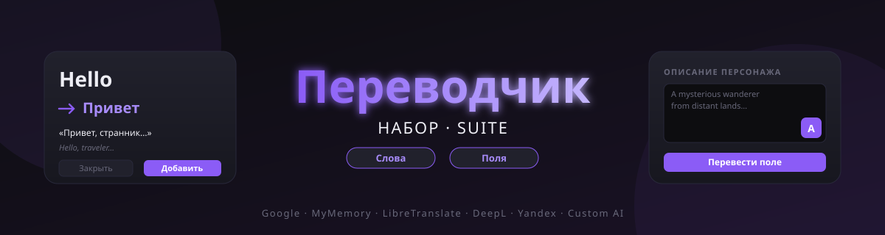

<p align="center">
  
</p>

<h1 align="center">Переводчик: Набор 🌐</h1>

<p align="center">
  <b>Два вида переводчика в одном расширении для SillyTavern.</b><br>
  Двойной клик по слову в чате — перевод и словарь.<br>
  Кнопка <i class="fa-solid fa-language"></i> в полях карточек — перевод описаний и World Info.<br>
  Цвета подстраиваются под тему Таверны (светлую и тёмную), провайдеры на выбор.
</p>

---

## ✨ Возможности

### 📖 Модуль «Слова» — чтение и словарь
- **Двойной клик / двойной тап** по любому слову в сообщении чата → перевод в красивой карточке
- Переводится не только слово, но и **контекст (предложение)**
- **Словарь** — копим все сохранённые слова, поиск, импорт/экспорт CSV
- **Избранное** — сохраняй цитаты: выдели текст и нажми кнопку рядом с курсором
- **Подсветка** сохранённых слов прямо в тексте чата

### ✏ Модуль «Поля» — карточки и лорбуки
- Маленькая кнопка <i class="fa-solid fa-language"></i> в углу каждого поля: описания персонажа, персоны, личности, сценария, примеров, приветствий, World Info и т.п.
- Удобное окно с двумя колонками: **оригинал** и **перевод**
- Перед заменой можно **отредактировать** результат
- **Быстрая смена языков** кнопкой <i class="fa-solid fa-right-left"></i>

### 🎨 Единая кастомизация (работает в обоих модулях)
- **Цвета идут от темы Таверны** — и светлой, и тёмной, ничего настраивать не нужно
- **9 цветов** (акцент, фоны, текст, границы…) можно слегка поправить; хранятся только изменённые, остальные следуют за темой
- Каждый модуль можно **включить/выключить** в настройках — используй только то, что нужно

---

## 🔌 Поддерживаемые провайдеры перевода

| Провайдер | Ключ | Примечание |
|-----------|------|-----------|
| **Google Translate** | не нужен | Через backend Таверны |
| **Yandex Translate** | ключ в секретах ST | Через backend Таверны |
| **LibreTranslate** | нет (сервер задан в ST) | Через backend Таверны |
| **DeepL** | ключ в секретах ST | Через backend Таверны |
| **Lingva Translate** | не нужен | Через backend Таверны |
| **Bing Translate** | не нужен | Через backend Таверны |
| **DeepLX** | нет (сервер задан в ST) | Через backend Таверны |
| **OneRing** | нет (сервер задан в ST) | Через backend Таверны |
| **MyMemory** | email (необяз.) | Напрямую из браузера, 1000 запросов/день без email |
| **Custom AI** (OpenAI-совместимый) | нужен | Напрямую из браузера — твой AI-эндпоинт |

Для Yandex/DeepL ключ вводится один раз в самой Таверне: **Extensions → Chat Translation → значок ключа** у нужного провайдера — сохранится в секретах ST и будет использоваться автоматически, без ввода в настройках этого расширения.

### 👤 Пол юзера и персонажа (Custom AI)
В **Настройки → Перевод** можно указать пол юзера и пол персонажа. Custom AI согласует окончания: реплики юзера переводятся от его лица («я пошла»), реплики персонажа — от лица персонажа, а обращения друг к другу получают нужный род («ты пришла»). Обычные переводчики (Google и др.) инструкций не принимают, поэтому для них настройки не действуют.

### 🗄 Кеш переводов
Уже переведённый текст берётся из кеша, поэтому повторные тапы по тем же словам и абзацам не тратят запросы. Кеш учитывает провайдера (и модель Custom AI), языки и настройки рода, так что после их смены старые переводы не подставляются. Во вкладке **Настройки → Кеш**: включение, лимит записей (100 / 300 / 1000), поиск, удаление отдельной записи значком корзины и кнопка «Очистить весь кеш». В карточке перевода кнопка <i class="fa-solid fa-rotate-right"></i> переводит заново мимо кеша и перезаписывает запись.

### 🔀 Автофоллбэк
Если выбранный провайдер не ответил — расширение автоматически пробует остальные бесплатные backend-провайдеры по очереди (кроме MyMemory и Custom AI — они подключаются осознанно, не как запасной вариант). Включается/выключается в **Настройки → Перевод → Автофоллбэк**.


---

## 📦 Установка

1. Распакуй папку `translator-suite` в:
   ```
   SillyTavern/public/scripts/extensions/third-party/translator-suite/
   ```
   (или поставь через **Install extension** по ссылке на репозиторий)
2. Открой SillyTavern → **Extensions** (значок пазла) → **Manage Extensions**
3. Включи «**Переводчик: Набор (слова + поля)**»
4. Обнови страницу

---

## 🚀 Использование

### Модуль «Слова»
1. **Двойной клик** по слову в любом сообщении чата
2. Появится карточка с переводом слова и контекста
3. Кнопка <i class="fa-solid fa-bookmark"></i> **Добавить** — сохранит слово в словарь
4. Кнопка <i class="fa-solid fa-book-open"></i> → открывает словарь (поиск, удаление, экспорт CSV)
5. Включи «Избранное» → выдели фразу в чате → кнопка <i class="fa-solid fa-star"></i> рядом с курсором сохранит её

### Модуль «Поля»
1. Открой карточку персонажа / World Info
2. Наведи курсор на любое поле — в правом нижнем углу появится <i class="fa-solid fa-language"></i>
3. Нажми её — откроется окно **перевода поля**
4. Нажми <i class="fa-solid fa-language"></i> **Перевести**, при желании отредактируй результат
5. <i class="fa-solid fa-check"></i> **Принять и заменить** — текст подставится в поле карточки

### Горячая клавиша
- `Esc` — закрыть любое окно переводчика

---

## ⚙ Настройки

Открываются через шестерёнку <i class="fa-solid fa-gear"></i> в любой карточке. Четыре вкладки:

| Вкладка | Что внутри |
|---------|-----------|
| <i class="fa-solid fa-puzzle-piece"></i> **Модули** | Включение/отключение «Слов» и «Полей» |
| <i class="fa-solid fa-language"></i> **Перевод** | Провайдер, ключ, URL, модель, системный промпт, языки |
| <i class="fa-solid fa-book"></i> **Чтение** | Подсветка словаря в чате, включение «Избранного» |
| <i class="fa-solid fa-palette"></i> **Цвета** | Цвета темы + правки поверх: пикеры с предпросмотром и кнопкой ↺ «вернуть цвет темы» |

---

## 🎨 Цвета и тема

Расширение берёт цвета из переменных темы Таверны (`--SmartThemeBodyColor`, `--SmartThemeBlurTintColor`, `--SmartThemeUnderlineColor`), остальные оттенки (панели, границы, второстепенный текст) вычисляются от них через `color-mix`. Поэтому окна одинаково аккуратно выглядят в светлых и тёмных темах и меняются вместе с ними. Цвет текста на кнопках акцента (белый/чёрный) выбирается автоматически по яркости фона.

Если что-то не нравится — **Настройки → Цвета**: поменяйте нужный цвет (результат виден сразу), затем «Сохранить». Кнопка ↺ у строки возвращает цвет темы.

---

## 🗂 Структура

```
translator-suite/
  ├── manifest.json   — манифест расширения
  ├── index.js        — вся логика (оба модуля)
  ├── style.css       — стили с CSS-переменными
  ├── banner.svg      — баннер для README
  └── README.md       — этот файл
```
---

<p align="center">
  <i class="fa-solid fa-heart"></i> Сделано с любовью для SillyTavern-сообщества
</p>
